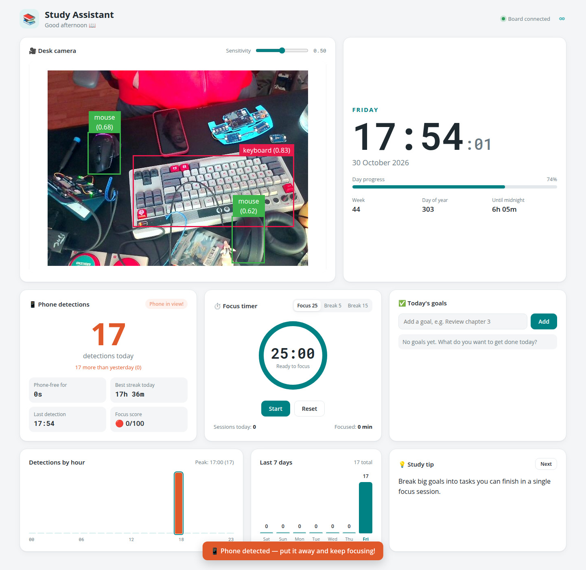
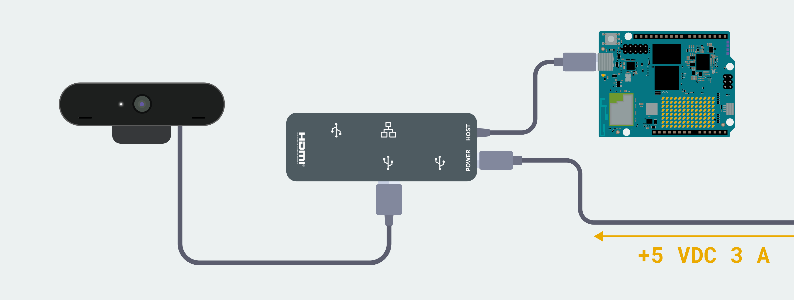
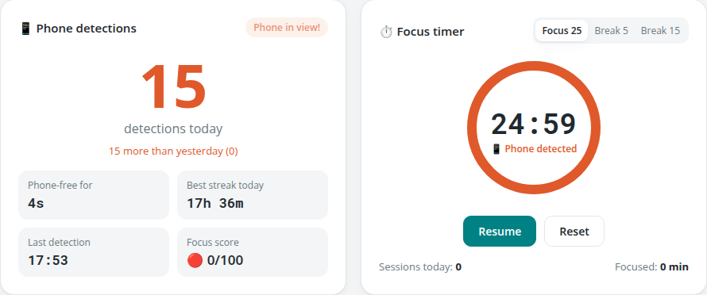

# Study Assistant - Phone Detector

The **Study Assistant** turns your Arduino UNO Q into a desk companion that helps you stay focused. A USB camera watches your desk and an AI model looks for cell phones in real time. Every time a phone shows up, a **Modulino® Buzzer** beeps, the detection is counted, and your focus timer pauses until the phone is gone.

A web dashboard shows the live camera, the time and date, a focus (Pomodoro) timer, today's goals, study tips and statistics on how often your phone distracted you during the day.



*This App is based on the **Detect Objects on Camera** example for the Arduino UNO Q.*

## Features

- 🎥 **Desk camera**: live camera feed with bounding boxes around every detected object, plus a sensitivity slider.
- 🕒 **Clock**: current time, day of the week and date, day progress, ISO week number, day of the year and time left until midnight.
- 📱 **Phone detections**:
  - number of detections today, compared with yesterday
  - live **Phone in view!** badge and a pop-up alert on each new detection
  - **Phone-free for**: time since the last detection
  - **Best streak today**: the longest phone-free stretch of the day
  - time of the last detection and a **focus score** out of 100
- ⏱️ **Focus timer**: 25-minute focus sessions with 5 and 15-minute breaks (a 15-minute break after every 4th session). It counts sessions and focused minutes for the day.
- 🔕 **Auto-pause**: if a phone is detected during a focus session, the timer pauses. It resumes on its own once at least 10 seconds have passed and the phone is out of view.
- 📊 **Charts**: detections by hour for today and detections over the last 7 days.
- ✅ **Today's goals**: a simple checklist for what you want to get done.
- 💡 **Study tips**: a new tip every minute, or on demand with **Next**.
- 🔔 **Modulino Buzzer**: a double beep every time a phone is detected. While the phone stays in view it keeps beeping, at most every 2 seconds.

## Bricks Used

- `video_object_detection`: runs a pre-trained object detection model on the live camera stream and draws the bounding boxes.
- `web_ui`: hosts the dashboard and the real-time messaging between the board and the browser.

## Hardware and Software Requirements

### Hardware

- Arduino® UNO Q (x1)
- USB camera (x1)
- USB-C® hub adapter with external power (x1)
- A power supply (5 V, 3 A) for the USB hub (e.g. a phone charger)
- Modulino® Buzzer (x1)
- Qwiic cable (x1)

### Software

- Arduino App Lab

**Note:** The App must run in **Network Mode** in Arduino App Lab, because the camera is connected through the USB-C® hub.

## How to Use the App

1. Connect the USB camera to the board through the powered USB-C® hub.

   

2. Connect the **Modulino Buzzer** to the Qwiic connector of the UNO Q.

3. Place the camera so it can see your desk.

4. Run the App from Arduino App Lab, or from the board's terminal:

   ```bash
   arduino-app-cli app start user:phone-detector-buzzer
   ```

5. Open the dashboard in your browser at `http://<board-ip>:7000` or `http://<board-name>.local:7000`.

6. Press **Start** on the focus timer and get to work. If a phone appears on camera, the buzzer beeps and the timer pauses until you put the phone away:

   

## How it Works

```
 USB camera ──► video_object_detection ──► python/main.py ──► Bridge ──► sketch.ino ──► Modulino Buzzer
                       │                        │
                       │ live stream (:4912)    │ web_ui messages (:7000)
                       ▼                        ▼
                 ┌────────────── Web dashboard (browser) ──────────────┐
                 │ camera · clock · stats · charts · timer · goals     │
                 └─────────────────────────────────────────────────────┘
```

### 🔧 Backend (`python/main.py`)

- Creates the `WebUI` and `VideoObjectDetection` Bricks (confidence 0.5).
- Registers `on_detect("cell phone", ...)`, which runs on every frame where a phone is seen:
  - If no phone was seen for more than **3 seconds**, it counts a **new detection**. The timestamp is saved and `phone_event` and `stats` messages are sent to the dashboard.
  - It calls `Bridge.call("beep")` at most once every **2 seconds**.
- Registers `on_detect_all(...)` to forward every detection to the dashboard as a `detection` message. The dashboard uses it for the **Phone in view** badge and the timer auto-pause.
- Saves the detection timestamps in `data/phone_events.json`, keeping the last 8 days, so the counters survive restarts.
- Listens for these messages from the dashboard:
  - `get_stats`: sends back the stored detection history
  - `override_th`: changes the detection confidence threshold (the sensitivity slider)

You can tune the behaviour with the constants at the top of the file:

| Constant | Default | Meaning |
| --- | --- | --- |
| `NEW_EVENT_GAP_SEC` | `3.0` | Seconds without a phone before a new sighting counts as a new detection |
| `BEEP_COOLDOWN_SEC` | `2.0` | Minimum time between two beeps while a phone stays in view |
| `HISTORY_DAYS` | `8` | Days of detection history kept on the board |

### 🔌 Microcontroller (`sketch/sketch.ino`)

- Starts the Bridge and the Modulino bus (`Modulino.begin(Wire1)`), and waits until the **Modulino Buzzer** is found.
- Provides a `beep` function to Python with `Bridge.provide("beep", beep)`. It plays a double tone: 2000 Hz, then 2600 Hz, 150 ms each.

### 💻 Frontend (`assets/index.html`, `assets/app.js`, `assets/style.css`)

- Embeds the live annotated camera stream from the detection Brick (`http://<board>:4912/embed`).
- Updates the clock every second.
- Works out the daily and hourly stats, streaks and the 7-day chart from the detection timestamps, using the browser's local time zone. The board itself runs in UTC.
- Runs the focus timer in the browser. It pauses on `detection` messages for `cell phone` during a focus session and resumes after at least 10 seconds (`PHONE_PAUSE_MIN_MS`), once no phone has been seen for 3 seconds (`PHONE_IN_VIEW_TIMEOUT_MS`).
- Keeps timer sessions, focused minutes, goals and the sensitivity setting in the browser's `localStorage`, so they are saved per browser.
- Switches to a dark theme automatically when your system uses dark mode.

## Project Structure

```
phone-detector-buzzer/
├── app.yaml               # App name, icon, description and Bricks
├── README.md
├── python/
│   └── main.py            # Detection logic, statistics and Bridge calls
├── sketch/
│   ├── sketch.ino         # Modulino Buzzer control
│   └── sketch.yaml        # Board profile and Arduino_Modulino library
├── assets/
│   ├── index.html         # Dashboard layout
│   ├── app.js             # Clock, stats, charts, timer, goals and tips
│   ├── style.css          # Dashboard styles (light and dark theme)
│   ├── libs/              # socket.io and the WebUI helper
│   └── docs_assets/       # Images used in this README
└── data/
    └── phone_events.json  # Detection history, created at runtime
```

## Troubleshooting

- **"Searching webcam…" stays on screen**: check that the camera is connected through a powered USB-C® hub and that the App runs in Network Mode.
- **No beep**: the sketch waits in `setup()` until it finds the buzzer. Check the Qwiic cable and that the Modulino's power LED is on, then restart the App.
- **Too many or too few detections**: move the **Sensitivity** slider. Higher values need a more confident detection.
- **Wrong day or hour in the charts**: the statistics follow the time zone of the computer showing the dashboard. Check that its clock is set correctly.
- **Reset the statistics**: stop the App and delete `data/phone_events.json`.
